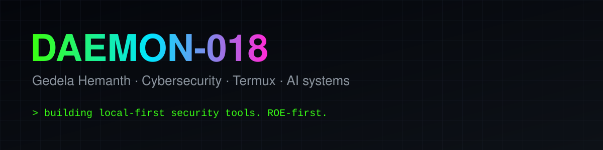

<div align="center">
  
</div>

<h1 align="center">Gedela Hemanth <code>@Daemon-018</code></h1>

<p align="center">
  <b>Cybersecurity learner · Termux developer · local-first AI builder</b><br/>
  I build small, sharp tools for authorized security work — and the autonomous agents that use them.
</p>

<p align="center">
  <a href="https://daemon-018.github.io/portfolio/"></a>
  <a href="https://github.com/Daemon-018?tab=followers"></a>
  
</p>

```text
$ whoami
Gedela Hemanth (Daemon-018) — cybersecurity learner & builder

$ cat focus.txt
local-first AI agents · Android/Termux tooling · authorized pentesting
```

---

## Featured projects

<div align="center">
  <a href="https://github.com/Daemon-018/DaemonMind">
    
  </a>
  <a href="https://github.com/Daemon-018/tmxssh">
    
  </a>
</div>

| Project | What it does |
|---------|--------------|
| **[DaemonMind](https://github.com/Daemon-018/DaemonMind)** | Zero-API-key autonomous AI security lab for Termux — ReAct agent, self-learning memory, keyless web intel, device-adaptive LLM routing. |
| **[tmxssh](https://github.com/Daemon-018/tmxssh)** | One-command SSH server starter for Android/Termux — auto-install, key setup, QR code. |
| **[NexH4ck](https://github.com/Daemon-018/NexH4ck)** | ROE-first Termux security lab with a curated tool catalog and APT repository. |
| **[portfolio](https://daemon-018.github.io/portfolio/)** | Personal site and project index. |

## Toolbox

<p>
  
  
  
  
  
  
  
  
</p>

## GitHub stats

<div align="center">
  
  
</div>

## Currently

- Shipping **DaemonMind v0.2** — hardened agent, safety guardrails, and CI.
- Maintaining **tmxssh** and the **NexH4ck** repository.
- Learning more about LLM routing, agent evaluation, and Android security.

## Rules of engagement

> I only build, test, and document techniques against systems I own or have explicit
> written authorization to test. Security tooling is dual-use — unauthorized access
> is illegal.

<p align="center"><i>ROE-first. Local-first. Ship small.</i></p>
